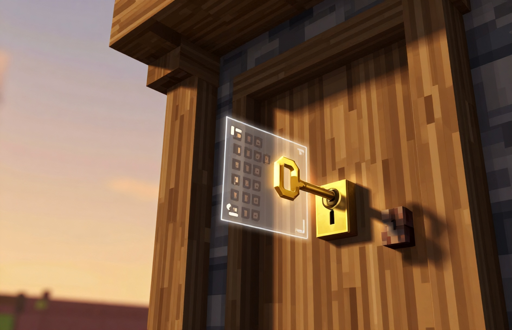

# GM Secure Doors

**Coded-key door locks for Minecraft Bedrock — vanilla doors, no padlock, no flicker.**

A locked door is swapped in place for a state-driven custom block that reuses the vanilla door
texture. Because the engine has no hand-open path for a custom block, the client never predicts a
swing — so locking a door doesn't make it flicker or jump. The key *is* the lock: nothing is
dropped, nothing is added, nothing is placed.



[garciamoonshine.com](https://garciamoonshine.com) · [Download v1.2.0](https://github.com/garciamoonshine/gm-secure-doors/releases/download/v1.2.0/GM-Secure-Doors-v1.2.0.mcaddon) · [Devlog post](https://garciamoonshine.com/blog/gm-secure-doors-coded-keys-for-vanilla-minecraft-doors/)

---

## What it does

| Action | Result |
|---|---|
| **Sneak + tap** a vanilla door with a Door Key | Locks it. The key gets a code (`K#a1b2c`) if it had none |
| **Tap** a locked door with the matching key | Opens it |
| **Tap** it again | Closes it |
| **Tap** without the key / with a wrong key | `Doors Locked` / `Wrong key`, nothing opens |
| **Sneak + tap** with the matching key | Releases the lock — it becomes a normal door again |
| **Break** a locked door | Refused (creative only) |
| **Blow it up** | Survives — locked doors are filtered out of explosions |
| **Pressure plate / lever** | Can only *close* a locked door, never open it |
| **Coded key + blank key in offhand** | Copies the code to the blank key |

Supported doors: **oak, spruce, birch, jungle, acacia, dark oak and iron doors** (both halves of
double doors are handled, and each door keeps its own hinge side, so a double pair still mirrors).

Deliberately **not** touched: trapdoors, fence gates, and other add-ons' doors (e.g. QB Doors).

## Install

1. Download the [`.mcaddon` release](https://github.com/garciamoonshine/gm-secure-doors/releases/download/v1.2.0/GM-Secure-Doors-v1.2.0.mcaddon)
   and open it — Minecraft imports both packs at once.
2. In your world settings, activate **GM Secure Doors** on both tabs: the **behaviour pack** and the
   **resource pack**.
3. On a dedicated server, add both pack folders to `behavior_packs/` and `resource_packs/`, then add
   their UUIDs to `world_behavior_packs.json` / `world_resource_packs.json`. New players receive the
   packs automatically on join.

Requires Minecraft Bedrock **1.21.90+** (Script API `@minecraft/server 2.0.0`). Tested on a
dedicated server running **1.26.52**.

## Crafting the Door Key

One **gold ingot** on top, one **iron nugget** underneath — a vertical two-item recipe in any
crafting grid (including the 2×2 inventory grid).

```
[ gold ingot  ]
[ iron nugget ]
        ↓
   Door Key  ×1
```

It also appears in the creative inventory under **Equipment**. The item has a gold/silver key icon
and holds exactly **one** code, so each door can have its own key if you prefer.

## Locking, opening, releasing

1. **Sneak + tap** the door while holding a Door Key. You get
   `Door Lock registered - only this key (K#a1b2c) opens it now.`
   The key is stamped with that code in its lore, and the door becomes a secure block that looks
   exactly like the door you placed.
2. **Tap** the door with that key to open, **tap again** to close.
3. Anyone without the key gets `Doors Locked` (empty hand) or `Wrong key` (a different coded key),
   and the door does not move.
4. **Sneak + tap** with the same key to release it — the door becomes an ordinary vanilla door
   again, in the same position and orientation.

A locked door cannot be broken (creative mode can) or destroyed by explosions, and redstone can only
close it — never open it.

## Copying a key (for family members)

Hold the **coded key in your main hand** and a **blank Door Key in your offhand**, then use the item.
The blank key receives the same code and you'll see `Copied K#a1b2c`.

Important: the code lives on the *item*, not the player — so give the copy to whoever should have
access, and keep the original yourself. A blank key is just a Door Key that has never locked a door
(any newly crafted one).

## How it works

The short version: **a locked door stops being a vanilla door, and becomes the add-on's own door
block that happens to use the vanilla texture.**

Vanilla doors are opened by the game itself. A script can cancel that interaction, but the client
has already animated its predicted swing and — because the server's block state never changed — no
corrective update is sent. The result is a door that visibly opens for half a second every time
somebody taps it while it's locked. There is no way around that from script alone, so the pack
swaps the door out for a custom block, for which the game has no hand-open path at all. Nothing to
predict, nothing to flicker.

The moving parts:

- **Two custom blocks per material** (`gm:sdoor_<material>_lower` and `_upper`) carrying the states
  `gm:dir`, `gm:hinge`, `gm:open`, `gm:upper`, `gm:mirror`, `gm:swing`, `gm:omirror`.
- **One geometry with 24 bones.** `bone_visibility` uses Molang block-state queries to show only the
  panel that matches the current state; `permutations` swap the collision and selection boxes to
  match, so an open door is genuinely walk-through.
- **Locking** reads the vanilla door's `minecraft:cardinal_direction`, `door_hinge_bit` and legacy
  integer `direction` state, plus its material, and records them. It then rebuilds *both halves* as
  secure blocks.
- **Opening** is a single block-state write (`gm:open = true`), which is also what keeps the door
  from ever being opened by the game.
- **Releasing** writes the recorded values back verbatim, so the door returns exactly as it was —
  same facing, same hinge, same texture, same position. The values are re-asserted a couple of ticks
  later, because vanilla re-derives a door's hinge when it is rebuilt next to its double-door partner.
- **Blocks carry `tag:door`**, so vanilla's double-door pairing still sees a door beside a door and
  leaves the neighbour's hinge alone.
- **Key codes** are stored in the item's lore (`K#xxxxx`) and cross-checked against the lock record
  kept in world dynamic properties, so the record survives restarts; copies are made by writing the
  same code to a second key.

## How hard this was

This add-on took far longer than its size suggests, because Bedrock's door data model is full of
undocumented traps. All of these were found the hard way:

1. **Two direction states.** Doors carry `minecraft:cardinal_direction` *and* a legacy integer
   `direction` (`cardinal=north` is `direction=2`). Restoring only the modern one leaves the door
   rotated, because the renderer uses the integer.
2. **Custom block faces are not what you expect.** A 3-pixel-thick panel needs UVs derived from each
   box's own dimensions; using one UV set for every state stretches the texture into a smear.
3. **The X axis is flipped.** In block-model space, the `+X` box renders on the world's west side.
   Everything was landing one cell-side off until that was measured.
4. **Oak is special.** The oak door *block* is `minecraft:wooden_door` (the item is `oak_door`), and
   its texture is `door_wood_*` rather than `door_oak_*`. Every other material follows
   `door_<material>_*` — and those textures are drawn mirrored relative to oak's, so non-oak doors
   need the opposite closed-pose flip.
5. **Halves disagree.** A door's two halves can hold *different* hinge bits; the **upper** half is
   the one that distinguishes the two doors of a double pair.
6. **Vanilla re-evaluates on rebuild.** Rebuilding a door next to its partner makes the engine
   re-derive the hinge, silently flipping it — so the door's state must be re-asserted after the
   block update settles, or it degrades on every lock/release cycle.
7. **Cancelling the interaction doesn't stop the animation.** `beforeEvents.playerInteractWithBlock`
   cancelling *does* stop the server-side open (verified: the block state stays closed), but the
   client keeps drawing its predicted swing for ~0.5 s because no corrective update is ever sent.
   That is why the lock has to be a custom block rather than a script on top of a vanilla door.
8. **Pack caching.** Bumping a manifest version is not enough: many clients keep serving the cached
   resource pack, so model changes never arrive. Changing the resource pack's **UUID** forces a
   re-download — worth knowing before spending an evening debugging code that was never loaded.

The final appearance rules were calibrated against eight vanilla doors, and are encoded as explicit
lookup tables (`CLOSED_MIRROR`, `OPEN_MIRROR`) plus `swing = hinge`.

## Licence and assets

- Code, JSON and the key icon: **MIT** (see [LICENSE](LICENSE)).
- **No Mojang assets are included.** The resource pack maps its atlases to the *client's own*
  vanilla door textures (`textures/blocks/door_*`), so nothing copyrighted is redistributed. The
  base game must be installed, which it always is.
- Not affiliated with Mojang or Microsoft.

## Changelog

- **v1.2.0** — doors self-heal their appearance (every tap and a background pass near players);
  pose rules re-calibrated against all eight orientations; console tools `gmsd:selftest`,
  `gmsd:inspect`, `gmsd:flipmirror`, `gmsd:setmirror`, `gmsd:fixlist` for per-door corrections.
- **v1.0.0** — first public release.

## Compatibility notes

- Other add-ons that replace vanilla doors, or that register their own `*_door` blocks, are not
  affected — this pack only accepts `minecraft:<material>_door` and `minecraft:wooden_door`.
- On a server, apply the packs once; new players receive them automatically.

---

Made by [GarciaMoonshine](https://garciamoonshine.com). Bug reports and pull requests welcome.
